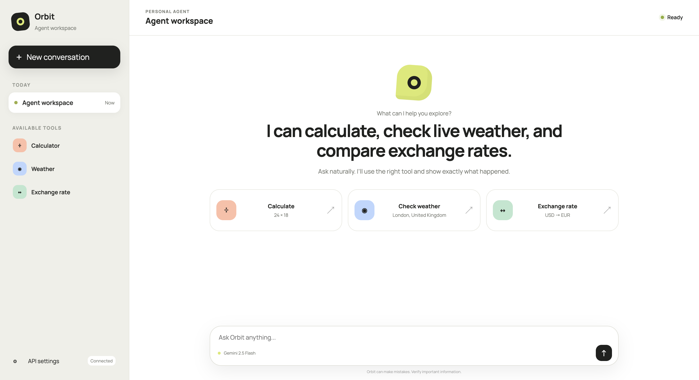

# Orbit Agent

A basic agentic AI chatbot built with Flask and Google Gemini. Orbit understands natural-language requests, selects the appropriate tool, and presents tool inputs and results alongside the final answer.



## Features

- Natural-language chat powered by Gemini 2.5 Flash.
- Calculator tool for arithmetic operations.
- Live weather lookup with WeatherAPI.
- Live currency exchange rates from Frankfurter.
- Visible tool calls with expandable input and result details.
- Conversation context with automatic summarization after ten messages.
- Responsive Material Expressive-inspired interface.
- API key configuration from the UI or environment variables.

## Available Tools

| Tool | Purpose |
| --- | --- |
| `invoke_calculate` | Add, subtract, multiply, divide, calculate a remainder, or raise a number to a power. |
| `invoke_weather` | Retrieve the current temperature for a city. |
| `invoke_exchange_rate` | Retrieve a current exchange rate between two currencies. |

Example prompts:

- `What is 24 multiplied by 18?`
- `What is the current weather in London?`
- `Convert 100 USD to EUR.`

## Project Structure

```text
Basic Agentic AI Application/
├── app.py                  # Flask application and chat endpoint
├── services/
│   └── llm_service.py      # Gemini and tool orchestration
├── tools/
│   ├── calculator.py       # Arithmetic operations
│   ├── exchange_rate.py    # Currency exchange service
│   └── weather.py          # Weather service
├── static/
│   ├── app.js              # Chat interactions
│   └── style.css           # Application styling
├── templates/
│   └── index.html          # Chat interface
└── screenshots/
    └── image.png           # Application screenshot
```

## Requirements

- Python 3.10 or newer
- A Google Gemini API key
- A WeatherAPI key for weather queries
- Flask and the Python packages used by the application

Install the dependencies:

```bash
pip install Flask python-dotenv requests numpy langchain-google-genai langchain-core
```

From the repository's `Souryadip Mallick FDE` directory, the shared requirements can also be installed with:

```bash
pip install -r requirements.txt
```

## Environment Setup

Create a `.env` file in this project directory:

```env
GOOGLE_API_KEY=your_google_gemini_api_key
WEATHER_API_KEY=your_weatherapi_key
```

Alternatively, enter the Gemini API key using **API settings** in the interface. The weather API key must be available to the server through `WEATHER_API_KEY` or the `.env` file.

## Run the Application

```bash
cd "Souryadip Mallick FDE/Basic Agentic AI Application"
python app.py
```

Open http://127.0.0.1:45000 in a browser.

## API Endpoint

### `POST /chat`

Request body:

```json
{
  "query": "What is 24 multiplied by 18?",
  "api_key": "optional_when_configured_in_environment"
}
```

Response:

```json
{
  "content": "24 multiplied by 18 is 432.",
  "tool_calls": [],
  "tool_results": []
}
```

Tool calls include their name, arguments, and result so the interface can render them clearly.
