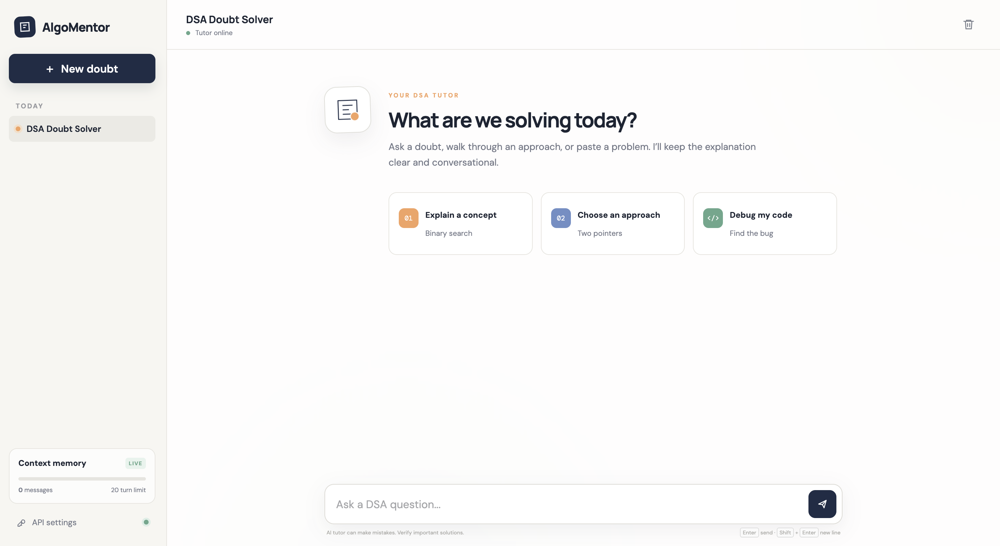

# AlgoMentor - DSA Doubt Solver

AlgoMentor is a Flask-based DSA tutoring chat application powered by Google's Gemini API. It includes conversation memory, context-window summarization, suggested prompts, Markdown responses, code formatting, and an API-key setup dialog.



## Features

- Ask Data Structures and Algorithms questions in a conversational interface
- Explain concepts, compare approaches, and debug code
- Render responses with headings, lists, inline code, and code blocks
- Preserve recent conversation context on the Flask server
- Summarize older context after the configured message threshold
- Store the Gemini API key locally in the browser
- Responsive desktop and mobile layout
- Reset conversation context from the UI

## Requirements

- Python 3.10 or newer
- Flask
- `langchain-google-genai`
- `python-dotenv`
- A Google AI Gemini API key

Install the project dependencies from the repository requirements file:

```bash
pip install -r "../requirements.txt"
```

## Run the app

From this project folder:

```bash
python3 app.py
```

Open:

```text
http://127.0.0.1:45000
```

Enter the Gemini API key through **API settings** in the sidebar.

## API

### `GET /`

Returns the AlgoMentor web interface.

### `POST /chat`

Sends a DSA question to Gemini.

```json
{
  "query": "Explain binary search",
  "api_key": "YOUR_GEMINI_API_KEY"
}
```

Successful response:

```json
{
  "content": "Binary search..."
}
```

### `POST /reset`

Clears the server-side conversation history and resets the context counter.

## Project structure

```text
DSA Doubt Solver with UI and Context Window Optimization/
├── app.py
├── README.md
├── services/
│   └── llm_service.py
├── static/
│   ├── app.js
│   ├── style.css
│   └── landing_page.png
└── templates/
    └── index.html
```
